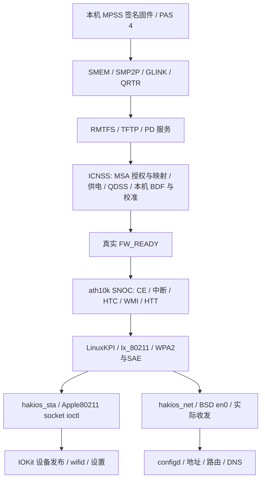

# Helium Raphael Wi-Fi 路线对 Nabu 的适用性

分析日期：2026-11-08，Asia/Shanghai。

结论：采用该分支的 **SM8150 / MPSS / ICNSS / WCN399x / ath10k SNOC** 路线作为 Nabu Wi-Fi 的主要移植参考是合理的。它比本地原有 Redwood WCN6750/ath11k 参考更接近 Nabu，而且已有作者报告的首次联网结果。当前最有价值的新线索是 **QDSS 时钟投票缺失**，随后是 MSA 的 SMMU 映射和完整 ath10k 后端接入。不能因此认定 Nabu 已可联网，也不能整套复制 Raphael 板级配置。

本次完成远端分支确认、源码下载及静态对照，新增本文；未修改生产驱动、构建或操作设备。已有未跟踪的 NabuWmi.h 等工作保留。下文把作者报告、源码事实和待验证假设分开。

## 1. 核对的版本与 CPU 前提

- 用户指定仓库：`https://github.com/HeliumStudio-Dev/hackios-xnu-kernel`。
- GitHub API 返回默认分支 `raphael-bringup`，本次 HEAD 为 `57722468a3774e2ec60017705ec356ae9b31f40e`，提交时间 2026-10-27 19:43:40 +08:00。
- 本地只读参考：`D:/github-IOS/research-sources/helium-hackios-raphael`，已下载 Wi-Fi、内核桥接、设备、构建与文档相关目录。
- Nabu 本次对照 HEAD：`00f70b4e051ab0c90d1c48ca9d996722b22dd809`，当前已有 v126 主机采集结果。

855 与 860 同属这里使用的 SM8150 平台路线，但“只扩大内存上限”不是准确的完整差异描述。小米 K20 Pro 官方规格明确列出 855 Prime 2.84 GHz；POCO X3 Pro 官方规格明确列出 860 Kryo 485 最高 2.96 GHz，均为 Adreno 640。内存上限不是判断 WLAN 驱动兼容性的依据；本次不对 855/860 最大 RAM 数值作未经官方资料确认的结论。

本次通过代理读取的厂商规格页：

```text
https://www.mi.com/in/redmi-k20-pro/specs/
https://www.po.co/global/product/poco-x3-pro/specs/
https://www.mi.com/global/product/xiaomi-pad-5/specs/
```

更直接的复用依据是两边 WLAN 的总线、MMIO、MSA、SID 和协议。Raphael 代码把无线标为 WCN3998，驱动硬件族仍选 `ATH10K_HW_WCN3990`；Nabu 已有资料支持 WCN399x，BT 为 WCN3991-compatible。不能把驱动族名当成两台设备无线芯片封装完全相同的证明。

## 2. 项目真正实现了什么

[README 最近实测](D:/github-IOS/research-sources/helium-hackios-raphael/README.md:23)记录 2026-10-27 首次 5 GHz WPA3 SAE H2E 连接、取得地址及网页访问；[Wi-Fi 文档](D:/github-IOS/research-sources/helium-hackios-raphael/docs/RAPHAEL-WIFI.md:5)还记录 2.4 GHz WPA2。

同一 README 明确记录关闭再开启后 `failed to power on device: -19`，无法重连。文档对“列表是否新扫描”也保留不确定性。因此应称其为“首次联网已有作者实测的实现”，不能称为开关、恢复、长期运行均稳定的成品。仓库未跟踪所引用的原始 `logs/*` 实机日志，本次无法独立复核那些原始运行记录。

其完整路径为：



实际源码与复用边界：

| 层 | 参考源码 | Nabu 应如何复用 |
| --- | --- | --- |
| 固件与控制面 | `xnu/files/bsd/dev/hakios.wifi.c`，`icnss_bootstrap` 在 4343 行 | 与现有 NabuModem/NabuGlink/NabuWlfw 比对缺项，保留本机固件和已有所有权管理 |
| Linux ath10k 编译 | `tools/mk-ath10k.py:123` | 固定版本源码加少量补丁，编译 core/ce/htc/htt/mac/wmi/snoc/qmi 等完整模块；不是只模拟扫描列表 |
| SNOC/XNU 适配 | `wifi/lx/ath10k/host.c:24`、`xnu/files/bsd/dev/hakios.lx.c` | 平台 probe、12 路 IRQ、NAPI、DMA、线程与 QMI 桥接；替换 Raphael 板级条件 |
| 扫描、关联、认证 | `wifi/lx/src/lx_80211.c`、`lx_wpa.c`、`wifi/lx/sae/` | 可移植的完整 station 后端；先验收 WPA2，再扩展 SAE/PMF |
| 原生系统入口 | `hakios.sta.c`、`hakios.apple80211.c`、`xnu/files/iokit/Kernel/hakios.wlan.cpp` | 复用原版 wifid 的 socket ioctl 路径、IOKit 属性及 BSD 接口；同时修正当前状态语义 |

`mk-ath10k.py` 固定 Linux 7.0.14、FreeBSD LinuxKPI 15.1、wpa_supplicant 2.11 和 Mbed TLS 3.6.7 的来源。这里仅记录脚本使用的版本，没有运行下载、编译或自测。

`firmware-5.bin` 在本分支 README:274–291 中是本地生成的 ath10k 接口描述，实际执行固件仍是设备的 `wlanmdsp.mbn`。移植时要核对 Nabu 固件的 WMI/HTT 接口及特性，不能把该辅助文件误认为可替换厂商固件的通用无线程序。

## 3. 硬件共同点与不能照搬的参数

| 项目 | Raphael 实现 | Nabu 证据 | 判断 |
| --- | --- | --- | --- |
| WLAN MMIO | `0x18800000 + 0x800000` | Android FDT 与公开 SM8150 DTS 一致 | 同一 SNOC 硬件路径 |
| MSA 保留区 | `0x8bc00000 + 0x180000` | 本机 FDT、WLFW 两区响应 | 地址相同，仍须分别处理安全权限与 IOVA 映射 |
| SMMU SID | `0x640`，mask 1 | 本机 FDT；当前代码分开管理 0x640/0x641 | 同族匹配；Nabu 已验证的 bank/ACTLR/清理不能被覆盖 |
| CE 中断 | SPI 414–425；GIC INTID 446–457，level-high | 公开 SM8150 DTS 同编号、level-high；Android FDT 编号相同但 flag 为 0 | 移植须明确 IRQ 编号约定，不能把 414 直接当 GIC INTID |
| 电源 | ldoa1/ldoa7/ldoc2/ldoc10/ldoc11，共五路 | Nabu 板源与本机 FDT 为 ldoa1/ldoa7/ldoc2/ldoc11，四路 | 不照搬新增 L10C 或更改 Nabu L11 电压 |
| BDF | `bd_f11cn.bin` / `bd_f11gl.bin` | Nabu 原生 daemon 实际选 `bd_k82c.bin` | 各用本机校准数据 |
| DMA 池 | `lx_base.c:774` 当前为 **44 MiB** | `NabuWlanDma.h:7` 为 128×64 KiB = **8 MiB** | 不能直接把现有分配函数接上就宣称驱动可启动 |

Nabu 原始 Android FDT 见 [device-tree.json](D:/github-IOS/XIAOMI_PAD5-NABU/log/host/wireless-v76/android/device-tree.json:11248)。公开板源见 [SM8150 WLAN 节点](D:/github-IOS/XIAOMI_PAD5-NABU/log/host/wireless-v76/source/arch/arm64/boot/dts/qcom/sm8150.dtsi:4680)与 [Nabu 供电节点](D:/github-IOS/XIAOMI_PAD5-NABU/log/host/wireless-v76/source/arch/arm64/boot/dts/qcom/sm8150-xiaomi-nabu.dts:1165)。公开 Linux 板源和本机 Android FDT 是不同来源，不能混称为原厂 Android 的同一段配置。

Raphael 的 `host.c:73` 假定 ICNSS 已持有五路电源和 QDSS，Linux regulator/clock 适配只是借用已有就绪状态。Nabu 应接入自己四路电源与时钟的真实状态；不能把这段返回成功的桥接层复制过来而遗漏底层上电。

## 4. 当前最值得验证的缺项：QDSS

源码证据链：

1. [Raphael icnss_power](D:/github-IOS/research-sources/helium-hackios-raphael/xnu/files/bsd/dev/hakios.wifi.c:4144)在电源请求完成后发送 `{class: clock, res: qdss, val: 1}`；退出发送 `val: 0`。`hakios_wifi_icnss_ready` 还把 QDSS 持有状态作为条件。调用点是 MSA/capability 后、BDF/校准前。
2. [Raphael 开发记录](D:/github-IOS/research-sources/helium-hackios-raphael/docs/RAPHAEL.md:54)描述此前已通过 MSA、BDF、CAL、MAC，却在校准后 WLAN PD 崩溃。修正 L10C 供电和 QDSS 后，两轮收到 `0x21 FW_READY`。记录把 CoreSight 访问与 QDSS 联系起来，但原始固件反汇编/运行日志未包含在本次公开源码中。
3. Nabu 使用的公开 SM8150 DTS 在 4685 行列出 `clock-names = "cxo_ref_clk_pin", "qdss"`，后者指向 `aoss_qmp`。已保存的 [qcom_aoss.c:279](D:/github-IOS/XIAOMI_PAD5-NABU/log/host/wireless-v76/source/drivers/soc/qcom/qcom_aoss.c:279)明确用同一条 QMP 文本开启时钟；同树 ath10k/snoc.c:1027 在电源开启后调用 `clk_bulk_prepare_enable`。
4. [当前 NabuModem.cpp:82](D:/github-IOS/XIAOMI_PAD5-NABU/patches/nabu-wireless/NabuModem.cpp:82)的 QMP 发送器仅构造 modem load-state 请求。无线模块中没有 QDSS clock 请求；CX/MSS/XO 的 RPMh 代理投票不是这条 QMP 请求。
5. [v126 采集报告](D:/github-IOS/XIAOMI_PAD5-NABU/log/host/wireless-v126/preliminary-result.json)仍记录首次 PFR `0xb019b9bc`、FW_READY/INIT_DONE=false、CE 未启动，且 PFR 发生在 BT worker 前。该报告标明完整运行日志回收待完成，不能把其摘要当作本轮全部验收完成。

因此 **QDSS 是有硬件描述、Linux 实现和成功参考分支共同支持的优先候选修复点**。但尚无 Nabu 故障读地址/调用者，也没有开启 QDSS 后的 Nabu A/B 实测；不能写成“已定位根因”或“改完必好”。同一个 MMIO helper PC 不保证访问同一个寄存器。

建议最小验证：在现有共享供电完成后、WLAN BDF/校准触发前，通过已有 AOP mailbox 锁发 QDSS 请求并记录 ACK，覆盖 WLAN 初始化和运行周期；停止必须遵循当前 MPSS/共享资源生命周期。先保持 Nabu 四路电源、BDF、SMMU 和 BT 顺序不变，单独比较 FW_READY、首次 PFR、SMMU fault 与清理结果。ACK 只证明请求被处理，最终仍以固件就绪和后续真实通信验收。

## 5. 第二个真实差异：MSA 的 SMMU 恒等映射

[Raphael icnss_smmu_prepare:5082](D:/github-IOS/research-sources/helium-hackios-raphael/xnu/files/bsd/dev/hakios.wifi.c:5082)除了打开无线 stream，还明确执行：

```c
radio_enter(0x8bc00000, 0x8bc00000, 0x180000, RADIO_PTE)
```

Nabu 的 [NabuMsa.cpp:9](D:/github-IOS/XIAOMI_PAD5-NABU/patches/nabu-wireless/NabuMsa.cpp:9)做安全所有权授予；[NabuWlanDma.h:125](D:/github-IOS/XIAOMI_PAD5-NABU/patches/nabu-wireless/NabuWlanDma.h:125)构造的是从 `0xa0000000` 开始的 8 MiB host DMA 映射，当前 ranges 没有 MSA 恒等区。这是已确认的实现差异。

MSA 的 XPU/VMID 授权和 host SMMU 页表是两件事；“授予成功”不能代替“这一路 DMA 地址能翻译”。但还需确认 Nabu 该阶段是否经 APPS SID 访问 MSA，当前资料不能证明它导致首次 PFR。应独立对照原机 ICNSS 映射行为及 fault，不与 QDSS 同轮盲改而失去因果区分。

## 6. 接入完整 ath10k 所需的实际工作

当前 [NabuWlanTransport.h:156](D:/github-IOS/XIAOMI_PAD5-NABU/patches/nabu-wireless/NabuWlanTransport.h:156)明确记录 `htt-and-setup-deferred`；[NabuWlanRuntime.cpp:108](D:/github-IOS/XIAOMI_PAD5-NABU/patches/nabu-wireless/NabuWlanRuntime.cpp:108)也注明 HTT/setup、scan/data 尚未启用。因此参考分支可节省大量后续 WMI/HTT/认证工作。

采用它需要完成以下边界，而不是复制文件后打开 `wifi=1`：

1. **统一 GLINK/QMI 所有者。** ath10k 的 qmi.c 走 HakiOS 的 `qmi_*` 与 `hakios_qrtr_ops`；当前 NabuGlink 是自己的端点与事务处理器。需提供真实 transport adapter 或有明确交接的控制面，不能让两个循环抢同一 GLINK FIFO/重复管理 MSA/BDF。`icnss-bootstrap.patch` 中 fw-ready 时重取 capability 的路径也应保留核对。
2. **选一个 CE/WMI/HTT 后端。** 完整 ath10k 开始管理 CE 后，停用当前试验性 CE transport 的寄存器与 ring 操作，复用其硬件验证成果和诊断资料。
3. **适配 DMA 契约。** 参考分支的 `lx_os_radio_memory` 申请连续内存及连续 CPU/IOVA 视图；Nabu 现有 8 MiB 是分块分配。44 MiB 池、映射、缓存属性、地址宽度、释放和页表容量需要实际设计，不能只改池大小常量。
4. **接入 level-high CE IRQ/NAPI。** Nabu 当前的 SMMU fault IRQ 不等于已接通 12 路 CE IRQ。按 GIC INTID 446–457 验证 attach/mask/unmask、线程处理及 RX/TX 完成。
5. **修改正确的构建入口。** Raphael `xnu-build.sh:7` 支持 `WIFI_OBJECT` 选择 ath10k；Nabu 当前引用基核脚本只取 ath11k 默认路径。必须修改受控构建和最终链接链路；只增加 Nabu 本地 prelink 模块不会替换基核内的旧 `lx_os_*`。两版本 header 的实质新增包括 `lx_os_radio_powered` 和 WPA3 枚举。
6. **复用已有原生接口并修正状态。** `hakios.wlan.cpp` 发布自有 IO80211Controller / IONetworkInterface；newUserClient 返回 Unsupported，框架走 socket ioctl。Nabu 基核已有这些元类与 net/station 入口，应适配已有实现，避免重复定义。参考分支仍有“无 station 也报 POWER on”等语义，且重启无线已知失败，不能原样继承后宣称完整生命周期。

原生 wifid 的包、真实 wlan 设备节点、接口早期发布和状态约束，继续使用已有 [v126 服务计划](D:/github-IOS/XIAOMI_PAD5-NABU/analysis/nabu-wifi-native-service-plan-v126.md)。当前 v126 软件采集仍无 wifid job、无线 IOKit 接口和 en0；固件 ready 修复与服务接入均需要完成。

## 7. 推荐落地顺序与验收

| 次序 | 工作 | 通过证据 |
| --- | --- | --- |
| 1 | 单独接入 QDSS 生命周期；对照 MSA 映射需求 | 当前实例收到真实 FW_READY/INIT_DONE，首个 PFR 消失或出现新的可定位错误；清理和 BT 基线保持 |
| 2 | ath10k 源码、适配层和基核构建；同轮准备 wifid/IOKit/BSD 接入 | 完整链接，无重复符号；真实 QMI/CE/HTC/WMI 初始化；未就绪状态不谎报可用 |
| 3 | 首次扫描与 WPA2 连接 | 新鲜 BSS、关联/密钥成功、双向收发、地址/路由/DNS、实际网页 |
| 4 | WPA3/PMF 与开关恢复 | SAE/密钥和管理帧路径实测；关闭重开为新扫描并重新联网，不能用缓存列表验收 |
| 5 | 与已工作的蓝牙并行验收 | BT 服务与操作、Wi-Fi 传输同时通过，资源撤销不破坏另一方 |

本轮成果是找到了更匹配且实现更完整的参考分支，以及 QDSS、MSA 映射、DMA 池和控制面交接这些具体差异。尚未产生 Nabu 新驱动产物，也没有新的硬件成功结果。

## 8. 用户认可后的接续核对（第127轮）

用户已认可本路线并要求继续。第126轮完整日志现已回收，确认29.548927秒PFR
早于29.549381秒BT worker启动；APFS计数96，DMA清理成功。第127轮先单独接入
QDSS QMP投票，保持Nabu四路供电、bd_k82c.bin及SMMU映射，实机待验。

第5节所列MSA恒等映射是实现差异，不能升级为必需补丁。既有
`analysis/nabu-wlan-prerequisite-followup-v115.md`已经直接核对：厂版Android
ICNSS没有wifi-firmware子节点，vendor attach没有MSA iommu_map；同系ath10k
没有该子节点时采用use_tz路径。第127轮独立复核确认该边界仍成立，因此暂不
增加MSA恒等映射，后续仅在实际访问路径或SMMU fault给出新证据时重新判断。

QDSS公开Linux设备树与原厂Android FDT仍是不同证据。当前基核未发现其他
APPS QDSS投票者，BT代码也没有QDSS请求，但不能据此断言远端固件或开机遗留
状态没有需求。新增on/off仅对应本轮实际提交的投票，正常运行保持，PAS停止
确认后撤销；详细限定见`analysis/nabu-wlan-qdss-review-v127.md`。
