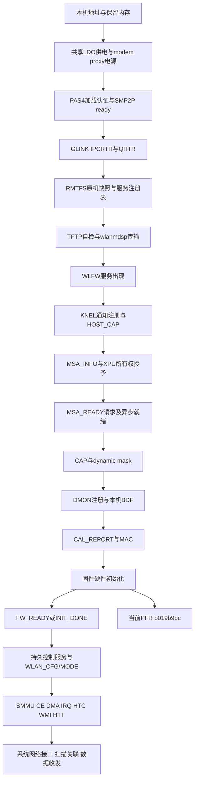

# Wi-Fi硬件启动层复查：第114轮

2026-11-07，Asia/Shanghai。按用户要求从供电到数据路径重新审查，覆盖当前
`patches/nabu-wireless`、本机Android FDT/日志、固定MiCode ICNSS与Nabu Linux
ath10k参考，以及第76至114轮已有结果。只读现有源码和证据，没有操作设备、
更改生产/测试代码、重复下载或哈希审查。本文不把DIAG无响应作为Wi-Fi初始故障根因。

## 结论

当前实现已经执行到原机WLAN固件的硬件初始化，但尚未完成这一步。第114轮仍在
CAL/MAC应答后发生`PC=0xb019b9bc`的保护域异常；已知该PC是WLAN MMIO读助手，
具体访问地址及电源/时钟故障条件仍未知。重新比对没有证明首次初始化少了REGDB、
校准文件、第五路供电或额外XO投票。

发现两个已被实机触发的生命周期问题：PFR/新端点继续沿用旧实例的`step=9`和
`complete=1`；固定时长结束后无条件关闭GLINK与modem。另有已经明确未实现的
SMMU/CE/HTC/WMI数据路径。前两项和数据路径缺口必须与软件使用层一起处理；
它们不能倒推为首次MMIO异常的唯一原因。

## 依赖图与当前证据

图中SMMU/CE资源在Android probe期可先建立；它们不必等到FW_READY才分配。
图示把其实际数据通信放到FW_READY之后，不能解释为要求在启动阶段故意省略资源。

| 阶段 | 当前真实结果 | 证据和边界 |
| --- | --- | --- |
| 板级地址 | MSA `0x8bc00000+0x180000`，modem `0x8e000000+0x9600000`，WLAN MMIO `0x18800000+0x800000` | 本机FDT，非参考板照搬 |
| 共享电源 | LDO请求752/1800/1304/3312mV均完成 | v114/v113 RPMh完成；PMIC观察读仍失败，不能宣称电压实际读回 |
| PAS4 | 元数据/内存/认证返回0；22段加载；SMP2P ready | v80起反复实测通过；不证明WLAN内部时钟已正常 |
| GLINK/QRTR | 双向IPCRTR、服务发现及请求/响应工作 | v81起通过；v114正常close-ack |
| RMTFS | 原机三文件打开、3次读、RAM共享权限成功 | 快照与写入仅RAM；本轮未见写入需求 |
| 服务注册/TFTP | 自检5字节成功，原机固件4,331,136字节传完 | v86起实测；非“仅有文件就算加载” |
| KNEL/QMI/MSA | 注册/hostcap/MSA_INFO/授予/ready/CAP/dynamic均正常应答 | 两区分别secure16KiB、nonsecure0x17c000 |
| MSA异步就绪 | v114实际收到0x2b，DMON注册状态0x4 | report271、282；不能把ready请求ACK单独当此证据 |
| DMON/BDF/CAL/MAC | 正确bd_k82c.bin五段、空CAL表、MAC全部应答0 | v114 report283..306；这是请求接受，不是硬件就绪 |
| 固件硬件初始化 | PFR `0xb019b9bc`；FW_READY/INIT_DONE均0 | 当前第一处已知失败的硬件阶段 |
| 启动后网络 | 还没有WLAN_CFG/MODE、SNOC数据路径、网络接口 | 当前只存在启动诊断试验，无法实际扫描联网 |

## 已确认问题，按影响排序

### 1. PFR和端点更换保留旧固件实例状态

`NabuGlink.cpp`的SERVREG PFR分支只退休ULog并捕获日志；WLFW NEW_SERVER分支
主要更新node/port。普通PFR场景没有清除`NabuWlfw.complete/step/waiting`、旧
capability、MSA-ready和FW_READY等实例状态；匹配DEL_SERVER只在rejuvenate分支
清理。第114轮实测新端点出现时仍打印`step=9 complete=1`，最终报告同样把旧
26,328字节BDF已发送和MAC已应用状态保留到新端点。

后果：固件第一次崩溃后，新实例不会重新获得KNEL/DMON初始化，软件使用层也无法
判断这些结果属于哪个实例。这是真实生命周期缺陷，不是首次MMIO异常的原因证据。

最小修复：在已确认WLAN PFR、当前端点删除/替换时取消旧事务、使当前实例资格
失效并停止旧待办；保留历史证据单独记录。不要仅把step清0后立刻自动重放，也
不要清掉实际XPU所有权账本。测试应复现PFR后旧reply/旧indication、新端点、
不相关端点删除，并证明不会继续旧BDF/CAL、不会重复grant。

### 2. 当前启动器是有界试验，无法提供持续硬件服务

`NabuGlink.cpp:992`固定30000轮循环后主动CLOSE IPCRTR、释放全部连接状态；
`NabuModem.cpp`随即发送stop、PAS shutdown并回收MSA/RMTFS。即使某轮收到
FW_READY，该路径仍会终止。软件界面接入不能弥补已经停止的modem与控制服务。

最小演进：先把试验期限与运行服务生命周期明确分开，再将成功启动的GLINK/QMI/
RMTFS/TFTP状态交给长期运行的服务持有。释放只能发生在显式停止或可证明已停止的
恢复路径。不能只删循环上限而保留栈/对象释放和无实例恢复的现状。验收至少需要
超过原试验窗口仍能读取真实固件状态及执行一条有效数据面操作。

### 3. SNOC硬件数据路径与WLAN运行配置尚未实现

本机FDT给出SMMU stream `0x640`、IOVA `0xa0000000+0x10000000`、IPA窗口
`0xb0000000+0x10000`和12个CE IRQ。Android `icnss_probe`在注册固件服务前建立
SMMU mapping/attach；之后驱动经`icnss_send_wlan_enable_to_fw`发送WLAN_CFG/MODE。
当前Nabu模块没有这些配置，也没有CE ring/DMA、HTC/WMI/HTT收发。

这是联网必需的缺口；不能把其他板的ath11k/WCN6750入口或假IOService当作补齐。
同样，已知PFR发生在DSP CPU的MMIO读助手；没有异常r0/r31或SMMU fault证据，
不能据“尚无SMMU”断言它导致了这次固件读寄存器异常。

最小路线：软件使用层先定义同一实例的真实ready契约；硬件层按Nabu实际IRQ、
stream/IOVA、WCN399x CE配置实现资源与运行命令，再用真实WMI事件和包计数逐级
验收。FW_READY仍是独立门槛，不由网络服务注册替代。

### 4. 已声明daemon支持，但持续校准服务只做了启动报告

HOST_CAP声明daemon_support，DMON订阅CAL_DOWNLOAD/UPDATE；当前接收器对
0x28/0x2a只记录消息，没有相应0x27/0x29请求与校准持久化。此项在当前完整日志中
尚未出现实际请求，因此不是已触发的首次失败原因；进入正常运行后仍属于缺失
的服务责任，应随长期生命周期一起补齐，不应伪造校准完成。

## MSA恢复不能只靠重新设置布尔值

原机MiCode路径的区别非常重要：

- `icnss.c:1363`在固件崩溃时清FW_READY；`icnss_qmi.c:1206`的clear_server只清
  WLFW_CONNECTED，不回收MSA、不清MSA0_ASSIGNED。
- 新server-arrive重新连接和power_on，然后IND_REGISTER。若返回ALREADY_REGISTERED，
  原机提前退出该初始化路径；否则再次MSA_INFO。
- `icnss.c:1022`只有MSA0_ASSIGNED为假才调用hyp assign；然后发送MSA_READY、
  CAP和dynamic mask。原机保留每region的当前perm，区别于协议的ready状态。
- 完整modem异常转储分支可暂收回HLOS读dump再重新grant；驱动remove/初始化失败也
  有单独回收路径。不能把任意WLAN PFR等同于这些完整停止边界。

当前`NabuMsa.cpp`的全局assigned[]是真实已授予账本。若清空Wlfw协议状态后直接
调用prepare，它仍以HLOS3为source再次grant，且会追加assigned_count；这不是正确
PDR恢复。自动恢复前必须核对新MSA_INFO布局与仍在账本中的地址/大小/secure一致，
匹配时复用已知owner，协议上重走ready；布局变化则停止并明确处理所有权。
第一次修复可以只失效旧会话并停止新发包，避免把恢复流程与根因修复混在一起。

## 已复核而未发现证据支持的“前期遗漏”

- 四路电源值已从v96对齐到本机Android；本机无第五路3.3V供电、可选cxo_ref_clk_pin
  属性或enable GPIO。不能因为cmd-db有rfclka2名字就认定必须新增投票。
- 原机FDT的fixed MSA phandle优先于备用`qcom,wlan-msa-memory=0x100000`，实际
  1.5MiB请求正确；secure VMID15/24与nonsecure15/24/25的RW授权匹配ICNSS。
- 第114轮MSA_READY异步通知先于BDF，DMON状态已是0x4，当前不是缺等待导致抢跑。
  代码仍应把ACK与异步条件分开表示，但不能称此表示修复已解决崩溃。
- `log/host/wireless-v91/android/cnss-log.txt:11..20`显示原机cal00..04全部不存在；
  22..24显示regdb.bin也不存在，25开始选择bd_k82c.bin且后续正常。
  因而空CAL表和当前未发REGDB符合这台机器，不能套用OnePlus的README要求。
- 旧generic bdwlan.bin在v91已经换成本机bd_k82c.bin；6144分段、显式BIN类型、
  独立KNEL/DMON、CAL可选字节和MAC请求均已对齐原机。不再重复换文件试错。
- DIAG是诊断观测路径；未找到它是WLAN上电、MSA或CAL成功的必要前置条件。
  第114轮control槽不再取重复包的证据可继续诊断，但不能取代上述硬件门槛。

## 接下来的最小证据计划

1. 先修已触发的会话失效与报告语义，保持首次初始化wire序列不变；本地状态机回放
   和完整CI后在实机确认“首次PFR仍保留、旧实例不再冒充当前状态”。
2. 对首次PFR建立时间线：LDO完成、PAS/SMP2P、FW加载、MSA授予和异步ready、BDF末段、
   CAL、MAC、PFR；新观测只围绕缺失的MMIO地址/调用者或可安全读取的电源/时钟状态。
   没有现场地址前不盲目读整个WLAN寄存器窗口或新增写时钟。
3. 同步建设持续服务与SNOC数据面。硬件ready、控制服务存活、WLAN运行配置、WMI事件、
   系统接口和扫描/关联/数据包作为不同事实，交由软件使用层消费同一实例状态。
4. CAL下载/更新和PDR完整恢复在真实请求出现或运行阶段需要时补齐；不能无限重试
   同一首次崩溃来替代根因定位。

主要来源均已在工作区保留：`patches/nabu-wireless/`；
`log/host/wireless-v76/android/device-tree.json`；
`log/host/wireless-v76/source/vendor/drivers/soc/qcom/icnss.c`；
`log/host/wireless-v90/source/icnss_qmi.c`；
`log/host/wireless-v76/source/drivers/net/wireless/ath/ath10k/{qmi,snoc}.c`；
`log/host/wireless-v91/android/cnss-log.txt`；
`log/host/wireless-v95/wlan-fault-analysis/findings.md`；
`log/host/wireless-v114/wireless-report.txt`。

## 接续修复与离线验证

已完成PFR、匹配DEL_SERVER和NEW_SERVER端点更换的实例失效修复。失效后清除
setup-complete、FW_READY、INIT_DONE、MSA协议ready、capability/status与MAC应用资格，
拒绝晚到响应/indication及后续初始化发送；保留最后step、BDF字节数和实际MSA授权
账本供历史诊断。此轮不自动重启、不重新grant，也不修改首次启动的QMI请求序列。
最终日志明确区分setup-complete与radio readiness，并输出instance-lost。

`tools/check_nabu_wlfw.py`和`tools/check_nabu_glink.py`已通过ASan/UBSan。
新增回归覆盖三种失效入口、普通BDF事务取消、迟到ready/init/rejuvenate、当前端点
重复公告、不相关删除，以及失效后无MSA regrant。PFR服务响应仍正常发送。
NabuGlink/NabuMsa的arm64内核对象编译通过。结果在
`log/host/wifi-recheck-v114/{wlfw-test,glink-test,compile}`。
完整CI与实机验证另行记录；首次b019b9bc异常原因仍未解决。
